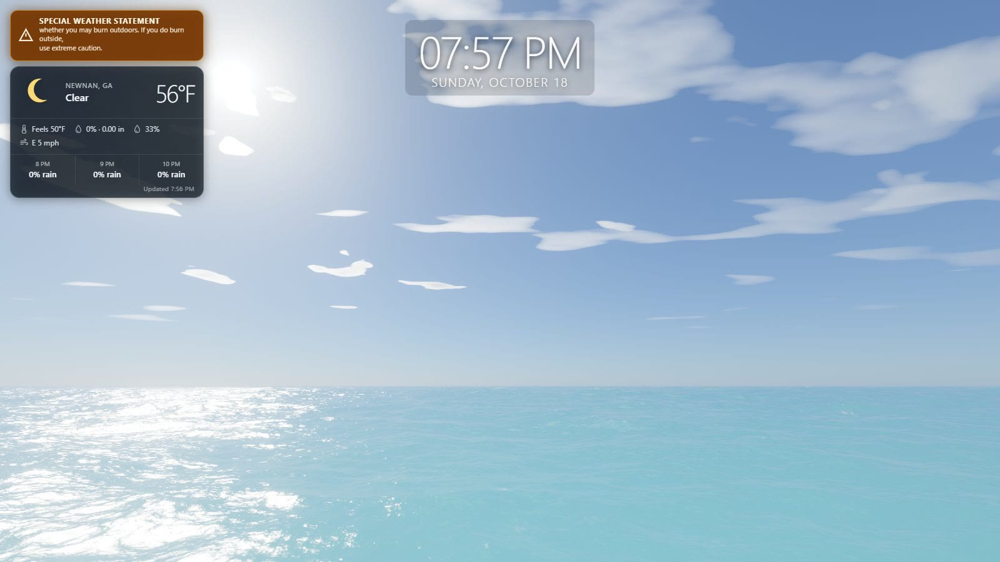
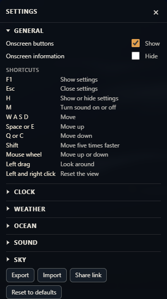
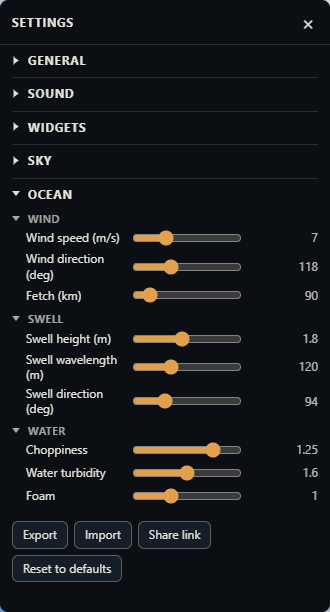
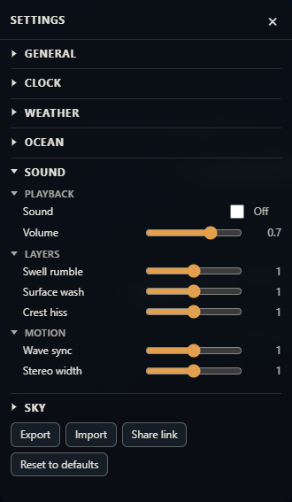
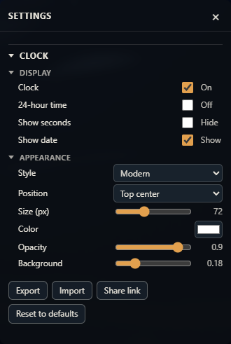
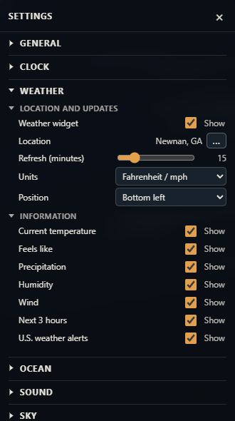
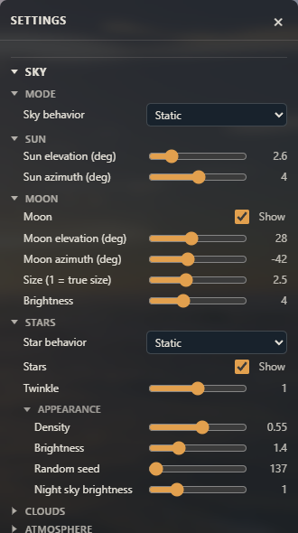
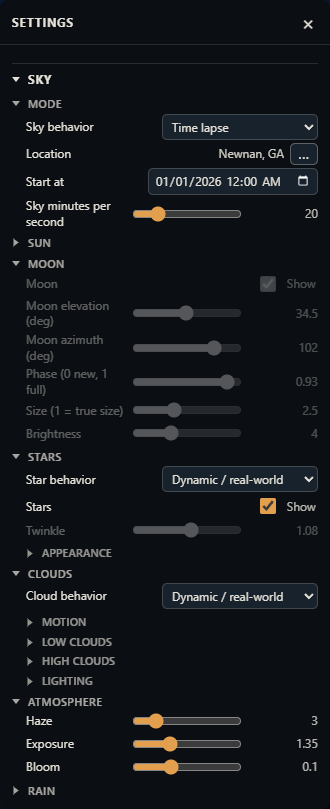
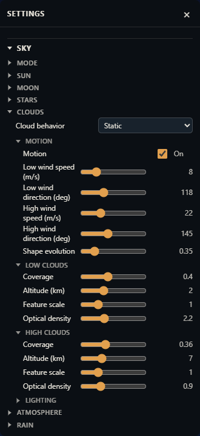
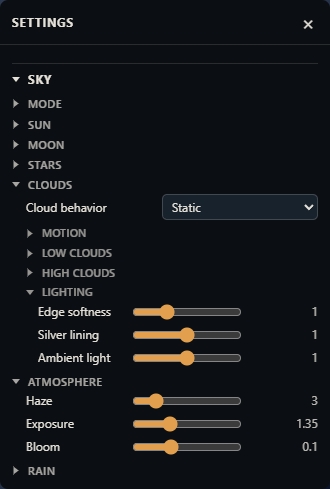

# fayling-web-ocean-pictureframe

A real-time ocean picture frame for a large screen. It draws a living sea — simulated waves, whitecaps, sun glitter, and a physically based sky — and keeps a clock, live weather, and procedural surf on the glass with it. The view is meant to stay up on a television.

This project is a fork of [web-ocean](https://github.com/Noniv/web-ocean) by [Maksymilian Dendura](https://github.com/Noniv). The wave simulation, water shading, atmosphere, and HDR post-processing come from that renderer. This fork adds the picture-frame overlays, ocean sound that follows the water under the camera, and a sky that can follow a real place and time.

The picture frame keeps a clock and live weather on the glass. This time lapse is Newnan, Georgia, starting at 7:56 PM on October 18, 2026. The clock keeps the real time, the weather card sits at the top left, and the sky runs forward from that moment. One real second advances the sky by 20 minutes, so the minute-long clip covers the night, the next morning, and the following afternoon.

[](https://jfayling.github.io/fayling-web-ocean-pictureframe/#timelapse)

[Play the 60-second time lapse with ocean sound](https://jfayling.github.io/fayling-web-ocean-pictureframe/#timelapse)

The clip is hosted on GitHub Pages, where the browser can play it with the procedural surf included. Press play and use the sound control to hear the water.

## Run it

You need a recent Chrome with WebGPU and a reasonably capable GPU. On a laptop, force Chrome onto the dedicated GPU in the Windows graphics settings, or it will fall back to the integrated one.

Open `ocean.html` directly in the browser. `ocean.min.html` is the same page, minified. Both are self-contained and work from `file://`.

To run from source:

```
npm install
npm start        # serves http://localhost:8080/
```

After editing anything under `js/`, run `npm run build` to regenerate both bundles. The minified build strips WGSL comments and whitespace and minifies the JavaScript with esbuild.

## Controls

| Input | Action |
|---|---|
| Hold left mouse button and drag | Look around |
| Left and right mouse buttons together | Reset to the default view |
| W A S D | Move |
| Space or E / Q or C, or the mouse wheel | Up / down |
| Shift | 5× movement speed |
| F1 or the Settings button | Open the settings panel |
| Esc, H, or the × button | Close the settings panel |
| H | Show or hide the settings panel |
| M, the Sound button, or the Sound setting | Toggle procedural ocean audio |

The camera keeps itself above the displaced water surface, so waves never pass through it.

The cursor is an open hand at rest and a closed hand while you are dragging. Looking around only happens while the left button is held. After a two-button view reset, the view stays still until you release the left button and press it again.

Sound and Settings sit together at the top right. They use the same surface as the settings panel and rest at low opacity so they stay out of the picture, then come forward on hover or focus. Onscreen buttons shows or hides them. Onscreen information shows or hides the frame rate, the control help, and, during a time lapse, the date, time, and place being rendered. Buttons are on by default. Onscreen information is off, so a television can show the ocean, the clock, and the weather without the diagnostics.

`ui=0` in the URL hides both the HUD and the buttons for that visit.

## Settings

The panel is an accordion. The sections are **General**, **Clock**, **Weather**, **Ocean**, **Sound**, and **Sky**. Opening one closes the others, and the groups inside a section work the same way. General lists the keyboard and mouse shortcuts. The pictures open a section’s groups together so the controls are visible.



Settings are saved in the browser and restored on refresh. A URL parameter overrides the saved value for that visit only. The camera is not saved. **Export** downloads every current setting as `ocean-settings.json`. **Import** supports every setting shown in the panel, applies recognized values, and leaves every omitted setting unchanged. Booleans such as `sound`, `showButtons`, and `showInfo` accept `true` or `false`. **Share link** copies a URL whose `s` parameter contains the full non-default configuration as base64url-encoded JSON. Only values that differ from the defaults are stored; opening the link restores the whole configuration for that visit, in place of the settings saved in the browser. Export and Share preserve the user's Static values while a Dynamic mode is active, so switching back to Static after an import or shared link restores the same manual setup. **Reset to defaults** restores every setting and the camera to the built-in values, with sound off, and writes those defaults into the saved session.

URL parameters are handy for testing. `?w=2560&h=1440` forces the render resolution, `cam=x,y,z,yawDeg,pitchDeg` sets the camera, `fov=deg` sets the field of view, and any settings key works too, for example `windSpeed=12&swellHs=2&sunElev=8`.

When a mode is Dynamic, Date and time, or Time lapse, the controls that mode calculates stay on screen, show the calculated values, and cannot be edited. They become editable again when you choose Static.

### Ocean



Wind, swell, and water. Wind speed, direction, and fetch shape the wind sea. Swell height, wavelength, and direction add a long-crested swell. Choppiness, turbidity, and foam tune the surface.

### Sound



Ocean audio is generated in the browser with the Web Audio API, so there are no sound files to download. Low swell, surface wash, and crest hiss are mixed from filtered noise. Their levels follow the simulated water height under the camera. Wind, foam, camera altitude, and the volume setting shape the result.

Sound starts off. The Sound checkbox, the Sound button, and M all control the same setting, and the choice is saved.

- **Swell rumble**, **Surface wash**, and **Crest hiss** set the level of each layer.
- **Wave sync** controls how strongly passing crests change the sound. At 1 the mix follows the water. At 0 it stays steady.
- **Stereo width** controls how far the wind shifts the sound between the ears.

### Clock



The clock is a picture-frame overlay, enabled by default, and it stays up when Onscreen information is hidden. It uses 12-hour time and shows the date unless you change those options. Display covers on/off, 12/24-hour time, seconds, and date. Appearance covers modern, monospace, or classic type, six screen positions, size, colour, opacity, and background strength. The default position is top center.

The clock shows the actual current time. In Date and time and Time lapse modes it does not follow the sky's simulated moment.

### Weather



The weather card is enabled by default for Newnan, Georgia (ZIP code 30265). Choose **…** beside Location, or click the place name on the weather card, type a city such as Toledo, and pick the matching place. Matching places are listed alphabetically, including the same name in more than one country, and the list scrolls when there are more than fit. After a pick, the dialog asks whether the other location should use that place too. A postal code with its country, a five-digit US ZIP code, or coordinates work in that same box. It shows a graphical current condition, temperature, today's expected high and low, feels-like temperature, precipitation amount and probability, humidity, wind, and the next three hours with the expected temperature and precipitation chance. Each item can be shown or hidden. Units are Fahrenheit and mph, or Celsius and km/h. The card can sit in any corner and starts at the bottom left. Refresh defaults to 15 minutes and can be set from 5 to 60.

A small timestamp at the bottom of the card shows when those conditions were last received. It follows the clock's 12-hour or 24-hour setting.

Active U.S. National Weather Service alerts appear above the card. The title stays put, and the statement scrolls through a few lines at a time so the full notice can be read. Severe and extreme alerts use a high-contrast red treatment. The settings panel stays above the weather card in every corner.

Current conditions come from [Open-Meteo](https://open-meteo.com/). US ZIP codes, and postal codes written with a country, are resolved through [`api.zippopotam.us`](https://api.zippopotam.us/). Other places are resolved through the [Open-Meteo geocoding API](https://open-meteo.com/en/docs/geocoding-api). Alerts come from [`api.weather.gov`](https://api.weather.gov/) and appear for United States locations only. The weather location is separate from the sky location, and both default to 30265.

### Sky



Sky behavior starts in **Dynamic / real-time**. Cloud behavior and star behavior start in **Dynamic / real-world**. Each can be switched to Static. The sky location defaults to ZIP code 30265.

| Mode | What it does |
|---|---|
| Static | Manual sun and moon together. The moon's phase comes from the angle between them. Stars, atmosphere, clouds, exposure, and bloom stay manual. The original camera view stays put. |
| Static (Day) | The sun controls only. The moon and the stars are hidden, in the panel and in the sky. |
| Static (Night) | The moon and star controls only, including phase. The sun stays below the horizon, so the sky is night. |
| Dynamic / real-time | The place chosen beside Location. Typing a name lists the matching cities, and the picked one is resolved to latitude and longitude and cached. The same prompt offers that place for the weather location. Sun and moon update from the current time every 30 seconds. |
| Date and time | The same place calculation, held at a date and local time you choose. |
| Time lapse | The same calculation, advancing on its own. It starts at January 1, 2026, 12:00 AM unless you pick another start. |



**Sky minutes per second** sets the time-lapse pace. The slider runs from 1 to 100 and starts at 20, so one real second advances the sky by 20 minutes. A larger value runs faster. After a full year the sky returns to the chosen start and repeats. With Onscreen information enabled, the display shows the date, time, and place currently being rendered.

Dynamic, Date and time, and Time lapse turn the view toward the sun and moon's daily arc, so they travel across the picture. The moon stays visible while it is above the horizon, including in daylight. Its phase, the angle of its lit side, and the tilt of its face come from the configured date, time, and place. It shows the near-side maria and bright craters, faint earthshine, and reddening near the horizon. In those modes the moon controls show the calculated elevation, azimuth, and phase, with size held at 2.5 and brightness at 4, and they cannot be edited. Static brings the manual moon controls back. In Static the sun lights the moon from wherever the sun sliders put it, so the phase comes from the angle between them and there is no phase slider. A moon near the sun is a thin crescent, a moon a quarter of the sky away is half lit, and only a moon opposite the sun is full. Static (Night) hides the sun and shows the phase slider, so the lit fraction is set directly and a crescent's horns point up. **Size (1 = true size)** defaults to 2.5 so the surface stays readable on a large screen, and the slider goes up to 6.

At night the renderer places 8,404 naked-eye stars from the public-domain Yale Bright Star Catalogue in their J2000 positions. The celestial sphere follows local sidereal time, so recognizable constellations rise, cross the sky, and set for the selected date, time, and location. Stars also twinkle independently to imitate atmospheric scintillation. The effect is subtle overhead and becomes stronger and more colorful near the horizon, where the starlight crosses more air. The **Twinkle** slider runs from 0 (steady) to 2 (pronounced) and defaults to 1. The moon does not twinkle because its visible disc averages out the turbulence. Haze, exposure, and bloom stay available. The sun position controls show the calculated elevation and azimuth and cannot be edited while a placed sky is calculating them.

Star behavior has the same Static and Dynamic / real-world choice as the clouds. Dynamic shows density, brightness, twinkle, catalog rotation, and night-sky brightness as calculated values and disables those controls. It sets them from the current darkness, moonlight, haze, cloud cover, sidereal time, and modeled atmospheric turbulence. Twinkle strength responds to cloud evolution, low- and high-level winds, wind shear, and clarity; each star's elevation still controls how much of that turbulence is visible. Dynamic / real-time recalculates it as conditions change, Date and time reproduces it for the chosen instant, and Time lapse evolves it with the simulated sky. A clear, moonless astronomical night shows the whole catalog against a faint airglow. Twilight, a bright moon, haze, and cloud cover leave the brighter stars and raise the sky glow. Static brings all manual values, including Twinkle, back. The random seed turns the catalog in a static sky; a placed sky uses the real orientation in either star mode.





Clouds are two independently moving layers, a broken low cumulus and a fibrous high deck. In Static mode each layer has its own wind direction, speed, altitude, scale, coverage, and optical density. Shape evolution changes the formations as they drift. Shared lighting controls tune edge softness, silver linings, and ambient light, and motion can be turned off. Lighting follows the sun through the day: warm transmission at sunrise and sunset, bright backlit edges, self-shadowed interiors, and cooler ambient bases. After dark the clouds stay visible in every sky mode. Moonlight brightens the faces turned toward the moon, and a cool ambient keeps the cloud shapes readable when the moon is down or hidden. A cloud hides the stars and the moon behind it. The thinnest edges still let a few stars through.

In Dynamic / real-world mode every cloud control follows a deterministic, location-dependent weather pattern. Synoptic systems evolve over several simulated days, with persistent nighttime cloud cover, daytime convective growth, changing cloud bases and density, plausible low/high-level wind shear, and faster high-level winds. Date and time reproduces the same conditions for the same place and instant, while Time lapse advances the weather with the simulated sky. This is a weather model rather than a live observation feed. The manual cloud controls stay visible but cannot be edited while Dynamic is selected, and the previous manual values return when Static is selected again. Cloud motion is accumulated a little at a time, so a change in wind or the periodic wave reset does not jump the whole layer.

## How it works

### Waves

The sea is a Tessendorf FFT simulation with six cascades of 256 by 256 samples. The patches range from 1103 m down to 0.26 m, so wavelengths run from about a kilometre to a few millimetres. The smallest cascade produces the sharp sun sparkles near the camera.

The spectrum is a fetch-limited JONSWAP wind sea with Donelan-Banner directional spreading, plus a narrow long-crested swell. Dispersion includes the capillary term, and choppy horizontal displacement sharpens the crests. The inverse FFTs are radix-2 compute shaders working in workgroup memory.

The surface mesh is a CDLOD quadtree with 17 levels. Vertices are 6.25 cm apart near the camera and the mesh reaches 160 km, with continuous vertex morphing between levels.

### Shading

- Mip-mapped first and second moments of the wave slopes (LEAN mapping) give the right anisotropic roughness at every distance. The sun glitter widens with distance and the far sea settles into a sheen without aliasing. Screen-space slope derivatives add specular anti-aliasing.
- Sun glitter uses an anisotropic Gaussian slope distribution with Smith masking and the size of the solar disc.
- The sky reflection comes from an environment cube map rebuilt every frame, with roughness-filtered mips. At grazing angles the reflection direction is tilted to account for which wave facets the viewer can actually see.
- The water body is turbid blue-green, lit by the whole sky hemisphere. Backlit crests get a subsurface glow, and wind-gust patches modulate the short ripples.
- Whitecaps start where the total surface Jacobian folds. Foam is stored in two camera-centred world-space maps (128 m and 1 km wide), decays over time, drifts downwind, and breaks into streaks as it ages. A procedural bubble texture gives it its structure.

### Sky

The atmosphere follows Hillaire's approach, with transmittance, multiple-scattering, and sky-view lookup tables plus aerosol haze. Cloud noise octaves are filtered by pixel footprint, and silhouettes are anti-aliased analytically: the screen-space derivative of each layer's edge function sets the width of its opacity edge. Cloud transmittance along the sun direction dims the sunlight that reaches the water, and aerial perspective is applied over the sea.

A celestial pass draws the phased moon and samples a color star map generated in-browser from the bundled Yale Bright Star Catalogue. Each catalog star carries a stable scintillation identity, which drives its own multi-frequency brightness and color variation. An atmospheric air-mass approximation strengthens the variation toward the horizon, while the environment map uses the mean star brightness so reflections remain stable. Placed sky modes compute the sun, moon, celestial pole, and equatorial orientation from the location and chosen instant. South of the equator the view faces north, so the daily arc still crosses the picture.

### Post-processing

The scene renders in HDR with 4× MSAA. Post-processing adds an 8-level bloom, AgX tone mapping, a slight white balance shift, and dithering.

## Performance

At 2560 by 1440 on an RTX 5070 Ti, the original renderer took about 6 to 8 ms of GPU time per frame, measured while other programs were also using the GPU. The HUD shows FPS and GPU time when the browser supports `timestamp-query` and Onscreen information is enabled.

The per-frame code reuses preallocated typed arrays and descriptors, so the garbage collector has almost nothing to do. The only recurring allocations are the objects WebGPU itself requires, such as the swap-chain view and command buffers.

## Known limitations

- Far water is still somewhat darker than the bright horizon sky above it.
- The water is tuned toward turbid coastal water. The "Water turbidity" slider gives darker, bluer deep water when turned down.
- The scene is open ocean only. There is no shoreline, surf, or objects in the water.
- Clouds are two flat layers, not volumetric.
- Dynamic sky, time lapse, and weather need a network the first time a place is resolved. Coordinates are cached after that. Weather and alerts need a network on each refresh.
- A five-digit number is read as a US ZIP code. Postal codes elsewhere need a country (`2000, Australia`), or use the city name. Very small places can be entered as latitude and longitude. City search uses English names.
- U.S. National Weather Service alerts are shown only for locations in the United States.

## How the original renderer was made

Maksymilian Dendura built [web-ocean](https://github.com/Noniv/web-ocean) with Claude Code (Opus 5.5). The goal was the most realistic water it could produce, in WebGPU, with a floating camera. The architecture and implementation were left to the model. It checked its own work by rendering screenshots in headless Chrome and having separate critic subagents review them. Feedback along the way, mainly on the clouds, led to replacing volumetric clouds with the flat layers and later fixing their edge aliasing.

The picture-frame additions in this fork — sound, clock, weather, placed sky modes, the moon and stars, and the settings panel — were built on top of that renderer.

## Repository layout

| Path | Contents |
|---|---|
| `index.html` | Page shell, HUD, clock and weather overlays, and settings panel styles |
| `js/main.js` | Device setup, resources, camera, settings, and the per-frame loop |
| `js/audio.js` | Procedural ocean audio driven by the wave probe |
| `js/astronomy.js` | Sun, moon, and star placement from time and location |
| `js/star-catalog.js` | Compact public-domain Yale Bright Star Catalogue and star-map generation |
| `js/weather.js` | Weather card and National Weather Service alerts |
| `js/wgsl/` | Shaders as JavaScript modules: `sim.js` (waves and foam), `sky.js` (atmosphere and clouds), `ocean.js` (surface and sky pass), `post.js` (bloom and tone mapping), `common.js` (shared structs) |
| `server.mjs` | Tiny static server for development |
| `build.mjs` | Builds `ocean.html` and `ocean.min.html` |
| `docs/` | Time-lapse clip, settings screenshots, and the GitHub Pages player |

## License

MIT. See [LICENSE](LICENSE).

Copyright (c) 2026 Maksymilian Dendura. This fork keeps that license and that copyright notice. The original project is [github.com/Noniv/web-ocean](https://github.com/Noniv/web-ocean).
